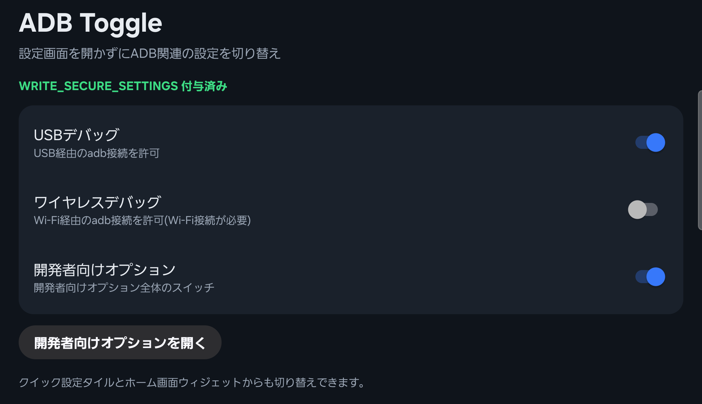

# ADB Toggle

Toggle USB debugging, wireless debugging and developer options from a Quick Settings tile, a home screen widget or the app, without digging through Settings.

Useful when an app (banking apps, for example) refuses to run while USB debugging is on and you switch it on and off often.



[日本語](#日本語)

## Features

- Switches for USB debugging, wireless debugging and developer options
- Quick Settings tiles (one per setting)
- Home screen widgets in 4 variants: bar (2 buttons), list (with ON/OFF status) and single-setting widgets for USB and Wi-Fi. Colors follow your wallpaper on Android 12+
- No root. Needs a one-time `adb` command to grant a permission
- No network access, no ads, no analytics

## Setup

1. Install the APK from [Releases](../../releases).
2. Enable USB debugging once and connect the phone to a PC with `adb`.
3. Grant the permission (once):

   ```
   adb shell pm grant io.github.ganondorofu.adbtoggle android.permission.WRITE_SECURE_SETTINGS
   ```

   The app shows this command with a copy button until the permission is granted.
4. Add the tiles (Quick Settings > edit) or the widget (long-press the home screen).

The permission stays after reboots and app updates. Uninstalling the app removes it.

## Notes

- Wireless debugging only turns on while connected to Wi-Fi.
- Turning USB debugging off also drops the current adb connection. Turn it back on from the phone.
- Some apps detect the developer options switch itself, not only USB debugging. Use the developer options toggle for those.
- The widget refreshes when you tap it or open the app, and every 30 minutes. If you change a setting somewhere else, it may lag behind.
- Tested on a Galaxy Z Fold (One UI 9, Android 17). Other devices and versions are untested. Samsung's Auto Blocker can block adb over USB.

## How it works

The app writes `adb_enabled`, `adb_wifi_enabled` and `development_settings_enabled` in `Settings.Global`. Writing these requires `WRITE_SECURE_SETTINGS`, which Android only lets you grant through `adb`.

## Build

Requires JDK 17 and the Android SDK (platform 35).

```
./gradlew assembleDebug
```

Release signing is read from `keystore.properties` (not committed).

## License

MIT

---

## 日本語

USBデバッグ、ワイヤレスデバッグ、開発者向けオプションを、クイック設定タイル・ホーム画面ウィジェット・アプリから切り替えるアプリです。設定画面の奥まで行く手間をなくします。

USBデバッグがオンだと起動しない銀行アプリなどを使うとき、頻繁にオン/オフを切り替える用途を想定しています。

### 機能

- USBデバッグ / ワイヤレスデバッグ / 開発者向けオプションのスイッチ
- クイック設定タイル(設定ごとに1つ)
- ホーム画面ウィジェット4種: バー(2ボタン)、リスト(ON/OFF表示付き)、USB・Wi-Fiの単体。Android 12 以降は壁紙の色に連動
- root不要。最初に1回だけ adb で権限を付与
- 通信なし、広告なし、解析なし

### 導入手順

1. [Releases](../../releases) から APK をインストールします。
2. USBデバッグを一度オンにして、PC と adb で接続します。
3. 権限を付与します(1回だけ)。

   ```
   adb shell pm grant io.github.ganondorofu.adbtoggle android.permission.WRITE_SECURE_SETTINGS
   ```

   付与するまで、アプリ内にこのコマンドとコピーボタンが表示されます。
4. クイック設定の編集からタイルを、ホーム画面の長押しからウィジェットを追加します。

権限は再起動やアプリの更新後も残ります。アンインストールすると消えます。

### 注意

- ワイヤレスデバッグは Wi-Fi 接続中のみオンになります。
- USBデバッグをオフにすると、現在の adb 接続も切れます。オンへの復帰は端末側で行います。
- USBデバッグだけでなく、開発者向けオプション自体を検知するアプリもあります。その場合は開発者向けオプションのスイッチを使ってください。
- ウィジェットは、タップ時・アプリを開いたとき・30分ごとに更新されます。他の方法で設定を変えた場合は、表示が遅れることがあります。
- 動作確認は Galaxy Z Fold(One UI 9、Android 17)のみです。他の機種やバージョンは未確認です。Samsung の Auto Blocker は USB 経由の adb をブロックすることがあります。

### 仕組み

`Settings.Global` の `adb_enabled`、`adb_wifi_enabled`、`development_settings_enabled` を書き換えます。書き込みには `WRITE_SECURE_SETTINGS` が必要で、この権限は adb 経由でのみ付与できます。

### ライセンス

MIT
